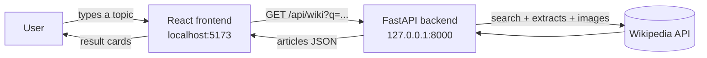

<div align="center">

# 🧭 DeepDriver AI

### Find the answers. Follow your curiosity.

A fast, elegant Wikipedia research companion. Search any topic and explore relevant articles, clean summaries, and original sources, all in a responsive light/dark interface.


[Features](#-features) · [Quick Start](#-quick-start) · [API](#-api-reference) · [Roadmap](#-roadmap) · [Troubleshooting](#-troubleshooting)

</div>

---

## 📸 Preview

<!-- Add screenshots to a /docs folder and uncomment:
<p align="center">
  
  
</p>
-->

> _Add a screenshot of the app here: save it as `docs/screenshot-light.png` and uncomment the block above._

---

## ✨ Features

- **Instant Wikipedia search**: results ranked by relevance, each with a clean plain-text summary, a thumbnail when available, and a link to the original article.
- **Editorial design**: serif headlines (Fraunces), a refined cream-and-burgundy palette, and subtle motion.
- **Light & dark themes**: follows your system setting on first visit, remembers your choice, and loads without a flash.
- **Fully responsive**: works from 320px phones to wide desktops, with 44px touch targets and safe-area support for notched devices.
- **Polished UX**: auto-growing search box, one-click suggestion chips, shimmer loading skeletons, and clear empty and error states.
- **Accessible**: keyboard-friendly, visible focus rings, `aria-live` result announcements, and reduced-motion support.
- **Clean API**: a small FastAPI backend that shapes Wikipedia's response into exactly what the UI needs.

---

## 🧱 Tech Stack

| Layer | Technology |
| --- | --- |
| Frontend | React 19, Vite 8, Tailwind CSS 4, Axios, Lucide icons |
| Backend | Python, FastAPI, Uvicorn, Requests |
| Data source | [Wikipedia Action API](https://www.mediawiki.org/wiki/API:Main_page) |

---

## 🏗 How It Works



---

## 📁 Project Structure

```
Wikipedia-Deep-Diver-RAG/
├── backend/
│   ├── main.py                # FastAPI app and /api/wiki endpoint
│   └── requirements.txt
├── frontend/
│   ├── index.html             # Fonts, theme bootstrap, meta tags
│   ├── package.json
│   ├── vite.config.js
│   └── src/
│       ├── App.jsx            # Page layout and search logic
│       ├── api.js             # Axios instance
│       ├── index.css          # Design tokens, themes, animations
│       ├── main.jsx
│       └── components/
│           ├── SearchForm.jsx
│           ├── ResultCard.jsx
│           ├── ResultSkeleton.jsx
│           └── ThemeToggle.jsx
└── README.md
```

---

## 🚀 Quick Start

### Prerequisites

- **Python** 3.9 or newer
- **Node.js** 20.19+ or 22.12+ (Vite 8 requires it; the current LTS is recommended)
- **Git**

Check your versions:

```bash
python --version
node --version
```

### 1. Clone the repository

```bash
git clone https://github.com/Anshikagarg-tech/Wikipedia-Deep-Diver-RAG.git
cd Wikipedia-Deep-Diver-RAG
```

### 2. Start the backend (Terminal 1)

```bash
cd backend
python -m venv venv
```

Activate the virtual environment:

```bash
# Windows (PowerShell)
venv\Scripts\activate

# macOS / Linux
source venv/bin/activate
```

Install dependencies and run:

```bash
pip install -r requirements.txt
uvicorn main:app --reload
```

The API is now live at **http://127.0.0.1:8000**. Check it at `/api/health`, or explore it interactively at `/docs`.

> 💡 On Windows PowerShell, if activation is blocked, run
> `Set-ExecutionPolicy -Scope Process RemoteSigned` and try again.

### 3. Start the frontend (Terminal 2)

```bash
cd frontend
npm install
npm run dev
```

Open the printed link, usually **http://localhost:5173**, and search for a topic. 🎉

Keep both terminals running while you use the app.

---

## ⚙️ Configuration

| Variable | Where | Default | Purpose |
| --- | --- | --- | --- |
| `VITE_API_URL` | Frontend (`.env`) | `http://127.0.0.1:8000` | Base URL of the backend API |
| `CORS_ORIGINS` | Backend (environment) | `http://localhost:5173,http://127.0.0.1:5173` | Comma-separated origins allowed to call the API |

Example: running the frontend on another port.

```bash
# macOS / Linux
CORS_ORIGINS=http://localhost:5174 uvicorn main:app --reload

# Windows PowerShell
$env:CORS_ORIGINS="http://localhost:5174"; uvicorn main:app --reload
```

---

## 🔌 API Reference

Base URL: `http://127.0.0.1:8000`

### `GET /api/wiki`

Search Wikipedia and return articles ready for display.

| Parameter | Type | Required | Description |
| --- | --- | --- | --- |
| `q` | string | yes | Search query (1 to 300 characters) |
| `limit` | integer | no | Number of results, 1 to 10 (default `6`) |

**Example**

```bash
curl "http://127.0.0.1:8000/api/wiki?q=roman%20aqueducts&limit=3"
```

**Response**

```json
{
  "articles": [
    {
      "title": "Roman aqueduct",
      "summary": "The Romans constructed aqueducts throughout their Republic and later Empire...",
      "url": "https://en.wikipedia.org/wiki/Roman_aqueduct",
      "thumbnail": "https://upload.wikimedia.org/..."
    }
  ]
}
```

`thumbnail` is `null` when the article has no lead image. If Wikipedia can't be reached, the API responds with `502`.

### `GET /api/health`

Returns `{"status": "ok"}`. Useful for uptime checks.

### `GET /api/hello`

Returns a short confirmation message that the API is running.

---

## 🛠 Scripts

Run these from the `frontend/` folder:

| Command | Description |
| --- | --- |
| `npm run dev` | Start the dev server with hot reload |
| `npm run build` | Create a production build in `dist/` |
| `npm run preview` | Preview the production build locally |
| `npm run lint` | Lint the codebase with ESLint |

---

## 🗺 Roadmap

DeepDriver AI currently handles **retrieval**: finding and presenting the most relevant Wikipedia articles. The next step is the full RAG loop:

- [ ] Generate a **grounded AI answer** from the retrieved articles, with inline source citations
- [ ] Fetch **full article text** and split it into passages for finer-grained retrieval
- [ ] **Embeddings + vector search** for semantic ranking
- [ ] **Streaming responses** for a faster-feeling answer panel
- [ ] Follow-up questions and conversation history
- [ ] Multi-language Wikipedia support
- [ ] Docker setup and one-command deployment

Ideas and contributions are welcome.

---

## 🩺 Troubleshooting

<details>
<summary><b>"Search failed. Please check that your backend is running."</b></summary>

1. Make sure the backend terminal is still running (`Uvicorn running on http://127.0.0.1:8000`).
2. Open `http://127.0.0.1:8000/api/wiki?q=test` in your browser. You should see JSON with an `articles` list.
3. If the frontend runs on a port other than 5173, set `CORS_ORIGINS` (see [Configuration](#️-configuration)).
4. Open the browser console (F12) and look for a red CORS error.

</details>

<details>
<summary><b>"Cannot find native binding" / <code>vite</code> is not recognized</b></summary>

Your Node.js version is probably too old. Install the current LTS from [nodejs.org](https://nodejs.org), reopen your terminal, then do a clean reinstall:

```bash
cd frontend
rm -rf node_modules package-lock.json     # PowerShell: Remove-Item -Recurse -Force node_modules, package-lock.json
npm install
```

</details>

<details>
<summary><b>The backend shows 404 at <code>http://127.0.0.1:8000/</code></b></summary>

That's expected. The backend is an API only. Open the frontend at `http://localhost:5173`, or visit `/docs` on the backend for interactive API docs.

</details>

<details>
<summary><b><code>uvicorn</code> is not recognized</b></summary>

The virtual environment isn't active. Run the activate command from [Quick Start](#2-start-the-backend-terminal-1), then `pip install -r requirements.txt` again.

</details>

---

## 🤝 Contributing

1. Fork the repository
2. Create a branch: `git checkout -b feature/my-feature`
3. Commit your changes: `git commit -m "Add my feature"`
4. Push the branch: `git push origin feature/my-feature`
5. Open a Pull Request

---

## 📄 License & Attribution

Article text and summaries are sourced from [Wikipedia](https://www.wikipedia.org) and are available under the [Creative Commons Attribution-ShareAlike License](https://creativecommons.org/licenses/by-sa/4.0/). Each result links back to its original article.

_Add a `LICENSE` file to specify the license for this project's own code (for example, MIT)._

---

<div align="center">

Built with curiosity · ⭐ Star the repo if you find it useful

</div>
